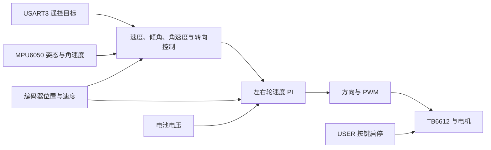

# STM32 两轮自平衡小车（铁头山羊版本）

基于 **STM32F103C8T6、STM32 HAL、CMake 和 VS Code** 的两轮自平衡小车学习工程。项目围绕电机驱动、编码器测速、姿态估计和闭环控制逐步开发，并包含电池电压显示、串口遥控和 RGB 呼吸灯。

当前固件采用 **裸机 `while (1)` 主循环 + `HAL_GetTick()` 分时调度**，未使用 FreeRTOS。代码中已接入平衡控制链路，但控制效果仍需要根据实际车体、传感器安装方向和电机参数进行调试；本 README 不代表实车性能验证报告。

## 功能概览

| 模块 | 当前源码中的实现 |
| --- | --- |
| 电机驱动 | TB6612FNG 总使能、左右轮方向控制、有符号 PWM 占空比输出 |
| 编码器 | A 相双边沿 EXTI 计数、累计角度、基于 TIM3 微秒计时的 T 法测速；无边沿达到 50 ms 后速度归零 |
| 姿态估计 | MPU6050 加速度与陀螺仪采集，Pitch/Roll 互补滤波，Yaw 角速度积分 |
| 轮速闭环 | 左右轮分别使用 PI，将目标电压按电池电压换算为 PWM 占空比 |
| 车身控制 | 速度、倾角、倾角角速度和转向控制，输出左右轮目标角速度 |
| 用户按键 | PA11 上拉输入，20 ms 稳定电平消抖；确认按下后切换电机启停 |
| 电池检测 | ADC1 注入组中断采样、电压换算、三颗电量 LED 分级显示 |
| 串口调试 | USART2 文本与 CSV 输出接口，可配合串口助手、VOFA 等工具使用 |
| 串口遥控 | USART3 中断接收文本行，解析 `move` 指令并设置直线、转向目标 |
| RGB 彩灯 | TIM2 PWM + DMA 驱动五颗 RGB 灯，默认执行五色同步呼吸效果 |

## 硬件与引脚

工程目标为 **STM32F103C8T6 / Cortex-M3**。当前配置使用 8 MHz 外部晶振，PLL 后系统时钟为 72 MHz；链接脚本按 **64 KB Flash、20 KB RAM** 配置。

以下引脚以当前 `balance_car.ioc`、`main.h` 和外设初始化代码为准，移植到其他板卡时需要与原理图逐项核对。

| 功能 | 引脚 | 配置或说明 |
| --- | --- | --- |
| TB6612 STBY | PA1 | 低电平待机，高电平使能 |
| 左轮 PWM | PA8 | TIM1_CH1 |
| 左轮 IN1 / IN2 | PA9 / PA10 | 电机方向控制 |
| 右轮 PWM | PB6 | TIM4_CH1 |
| 右轮 IN1 / IN2 | PB5 / PB7 | 电机方向控制 |
| 左轮编码器 A / B | PB14 / PB15 | A 相双边沿外部中断，B 相用于判向 |
| 右轮编码器 A / B | PB3 / PB4 | A 相双边沿外部中断，B 相用于判向 |
| MPU6050 SCL / SDA | PB8 / PB9 | I2C1 重映射，100 kHz；代码使用 7 位地址 `0x68` |
| 电池电压采样 | PB0 | ADC1_IN8，需通过板上分压电路接入 |
| 电量 LED1 / LED2 / LED3 | PA4 / PA5 / PA6 | 当前软件定义为高电平点亮 |
| USER 按键 | PA11 | 上拉输入，低电平按下 |
| 调试串口 TX / RX | PA2 / PA3 | USART2，921600 波特率，8N1，无流控 |
| 遥控串口 TX / RX | PB10 / PB11 | USART3，9600 波特率，8N1，无流控 |
| RGB 数据 | PA0 | TIM2_CH1，DMA1_Channel5 |
| SWD 调试 | PA13 / PA14 | SWDIO / SWCLK，连接调试器时共地 |

为使用 PB3、PB4，工程已关闭 JTAG 并保留 SWD。TIM3 配置为 1 MHz、16 位计数器，供编码器测速使用。

## 软件结构

```text
balance_car_vscode/
├── Core/
│   ├── Inc/                   # 应用接口、参数和 HAL 外设头文件
│   └── Src/
│       ├── main.c             # 初始化和主循环
│       ├── app_bat.c          # ADC 电池采样、电量灯
│       ├── app_button.c       # 按键消抖、电机启停
│       ├── app_pwm.c          # TB6612 方向、PWM 和 STBY
│       ├── app_encoder.c      # 编码器位置与速度
│       ├── app_motor.c        # 左右轮速度 PI
│       ├── app_mpu6050.c      # IMU 驱动与姿态估计
│       ├── app_control.c      # 车身平衡、速度和转向控制
│       ├── app_rc.c           # 串口遥控协议
│       ├── app_rgb.c          # PWM DMA 彩灯
│       ├── app_usart2.c       # 调试输出
│       ├── pid.c              # PID 实现
│       └── qmath.c            # 数学辅助函数
├── Drivers/                   # STM32 HAL 和 CMSIS
├── Test/                      # 单项硬件测试与主机行为检查
├── cmake/                     # ARM 工具链和 CubeMX 构建配置
├── .settings/                 # STM32Cube 工具依赖和设备配置
├── .vscode/                   # VS Code 工程配置
├── docs/                      # 开发设计与实施记录
├── balance_car.ioc            # STM32CubeMX 配置入口
├── CMakeLists.txt             # 应用源码和链接配置
├── CMakePresets.json          # Debug / Release 预设
├── STM32F103XX_FLASH.ld       # Flash / RAM 布局
└── startup_stm32f103xb.s       # 启动文件
```

`build/` 和 `tmp/` 分别用于本机构建结果与临时备份，已由 `.gitignore` 排除。工程目录和 GitHub 仓库名为 `balance_car_vscode`，CMake 目标名为 **`balance_car`**，因此生成的固件名称是 `balance_car.elf`。

## 构建与烧录

### 1. 准备开发环境

需要 VS Code、STM32CubeMX，以及 CMake、Ninja、GNU Arm Embedded 工具链。使用 ST 的 VS Code 扩展时，先让扩展完成工程识别和工具依赖安装。

当前 `.settings/bundles.store.json` 记录的主要工具版本：

| 工具 | 工程记录版本 |
| --- | --- |
| CMake | `4.3.1+st.1`，项目最低要求为 3.22 |
| Ninja | `1.13.1+st.1` |
| GNU Tools for STM32 | `14.3.1+st.2` |
| STM32CubeProgrammer | `2.23.0` |

在 VS Code 中打开仓库根目录，选择 CMake 的 `Debug` 配置预设并构建。仓库的 VS Code 配置使用 `cube-cmake`，由 STM32Cube 扩展接入工具环境。

### 2. 命令行构建

如果使用普通终端，需要让 CMake、Ninja、`arm-none-eabi-gcc` 和 `arm-none-eabi-g++` 都能从 `PATH` 找到。在仓库根目录执行：

```powershell
cmake --preset Debug
cmake --build --preset Debug
```

在 STM32Cube 工具环境中，也可将上述 `cmake` 命令替换为 `cube-cmake`。构建 Release 时，将两个命令中的预设名称都改为 `Release`。

Debug 输出主要位于：

```text
build/Debug/balance_car.elf
build/Debug/balance_car.map
build/Debug/compile_commands.json
```

复制或移动工程时不要沿用旧的 `build/` 缓存；CMake 缓存含有本机绝对路径，需要在新位置重新配置。

### 3. 烧录与首次运行

1. 首次调试先架空车轮，确认电机电源、逻辑电源、传感器和调试器连接正确。
2. 通过 ST-Link 的 SWD 接口连接目标板，可在 STM32CubeProgrammer 中下载 `build/Debug/balance_car.elf` 并复位；也可使用已配置好的 VS Code STM32Cube 调试、下载流程。
3. 打开 USART2 对应串口，设置为 **921600 / 8N1 / 无流控**，再复位开发板。
4. 初始化过程中会输出 `Balance Car Start!`。这条信息位于 MPU6050 初始化之前，收到它并不表示后续初始化已全部完成。
5. 电机驱动默认待机。系统完成初始化后，按下 USER 键使能电机，再按一次关闭；切换时会复位控制历史并清零电机输出。

MPU6050 初始化写入失败时会进入 `Error_Handler()`。如果能收到启动文字但主循环没有响应，优先核对 I2C 接线、供电及设备地址。

## 运行与控制逻辑

主循环依次处理电池采样、电量灯、按键、轮速 PI、IMU、车身控制、遥控命令和 RGB 刷新。



各模块的标称执行间隔为：轮速 PI 1 ms，IMU、车身控制与遥控处理 5 ms，电池采样启动间隔 10 ms，RGB 更新 20 ms。它们由主循环调用，不是独立的 RTOS 任务；I2C 读取和部分串口发送仍使用阻塞式 HAL 接口，实际节拍会受到通信耗时影响。

### 需要按实物核对的参数

| 参数 | 位置 | 当前值或含义 |
| --- | --- | --- |
| ADC 参考电压与分压系数 | `Core/Inc/app_bat.h` | `BAT_ADC_VREF = 3.3f`，`BAT_DIVIDER_RATIO = 2.5f` |
| 编码器计数与减速比 | `Core/Src/app_encoder.c` | 由 `ENCODER_DEGREES_PER_COUNT` 和 `ENCODER_RADIANS_PER_COUNT` 换算 |
| 车轮半径与模型长度 | `Core/Src/app_control.c` | `r = 0.032 m`，`lp = 0.062 m` |
| 轮速 PI | `Core/Src/app_motor.c` | 左右轮初值均为 `Kp = 0.5`、`Ki = 7.0` |
| 车身与转向控制参数 | `Core/Src/app_control.c` | 在 `App_Control_Init()` 中配置 |
| 按键消抖 | `Core/Src/app_button.c` | 原始电平连续稳定至少 20 ms |

左右轮的“正方向”和 IMU 的安装轴向必须与控制模型一致。移植或更换电机后，应先分别验证 PWM 方向、编码器反馈符号和姿态角方向，再进行闭环调参。

### 电池指示

电池电压由 ADC 原始值按软件参考电压和分压系数换算，分压参数应按实际电路校准。

| 电池换算电压 | 指示状态 |
| --- | --- |
| 大于 7.9 V | 三灯亮 |
| 大于 7.4 V，且不超过 7.9 V | 两灯亮 |
| 大于 7.0 V，且不超过 7.4 V | 一灯亮 |
| 大于 6.5 V，且不超过 7.0 V | 三灯灭 |
| 不超过 6.5 V | 三灯同时闪烁，100 ms 翻转一次 |

尚未取得首个 ADC 样本时，电量灯保持熄灭。低压闪灯是指示逻辑，当前代码没有据此自动关闭电机。

## 串口遥控协议

遥控数据通过 **USART3：PB10 TX / PB11 RX，9600 / 8N1** 接收，可连接串口或蓝牙透传模块。调试输出使用 USART2，两者引脚与波特率不同。

命令格式：

```text
move <转向整数> <前后整数>
```

每条指令末尾必须带 `CR`、`LF` 或 `CRLF`。代码的换算关系为：

```text
目标直线速度（m/s）   = 前后整数 × 0.01 × 0.7
目标转向角速度（rad/s） = 转向整数 × 0.01 × 15.0
```

例如，下面每行是一条命令，发送时附加换行：

```text
move 0 10
move 10 0
move 0 0
```

分别设置直线速度为 `0.07 m/s`、转向角速度为 `1.5 rad/s`、两项目标都归零。实际运动方向取决于电机、编码器和 IMU 的方向约定。

`move 0 0` 不会关闭 STBY，电机使能时平衡控制仍然运行。当前解析器未对两个整数做范围限制，也未实现遥控断连后的超时归零；调试时使用小幅度指令，并保留可操作的停机方式。

## RGB 呼吸灯

当前驱动使用 800 kbit/s 的 GRB 编码，通过 TIM2_CH1 PWM 和 DMA 异步发送。五颗灯分别显示红、绿、蓝、黄、紫，20 ms 更新一次，标称 2 s 完成一轮呼吸。

`App_RGB_SetColor()` 与 `App_RGB_Show()` 可设置、发送颜色；主循环中的 `App_RGB_Proc()` 会持续更新呼吸效果并覆盖手动颜色。需要固定颜色时，应先调整呼吸任务，而不是只调用一次 `SetColor()`。

## 测试与调试

### 单项硬件测试

测试入口位于 `Test/`，可按需要接入初始化区和主循环：

| 测试 | 入口 |
| --- | --- |
| 电池电压 | `Test_Voltage_Init()`、`Test_Voltage_Process()` |
| 编码器累计角度 | `Encoder_Test()`，输出左右角度，单位为度 |
| 编码器测速 | `Encoder_M_Method_Test()` 或 `Encoder_T_Method_Test()`；两者输出单位不同，见源码 |
| PWM 方向与启停 | `Test_PWM_Init()`、`Test_PWM_Process()` |
| MPU6050 原始数据 | `Test_MPU6050_Init()` |
| 姿态角观察 | `Test_EularAngleTest()`，名称沿用源码 |

编码器和 MPU6050 的独立测试入口包含不返回的循环。选择单项测试时，应安排好入口，并停用会争用电机控制的正常应用流程；尤其不要同时运行 PWM 测试和正常电机、平衡、按键启停逻辑。

CMake 中保留了 `BALANCE_CAR_TEST_MODE` 选项，但当前 `main.c` 没有对应的 `APP_TEST_MODE` 条件分支，单独设置这个选项不会自动切换测试入口。

部分测试采用较长延时，适合观察数据，不应作为正常控制环的运行节拍或姿态精度验证依据。更多操作见 [硬件测试说明](Test/README.md) 和 [编码器速度学习记录](ENCODER_SPEED_TUTORIAL.md)。

### 主机行为检查

仓库提供以下 PowerShell 脚本。在根目录运行前，需要本机 `PATH` 中有可生成 Windows 可执行文件的 **GCC / MinGW**；这里使用的不是 `arm-none-eabi-gcc`。

```powershell
.\Test\host\run.ps1
.\Test\host\run_rc.ps1
.\Test\host\rgb_dma\run.ps1
.\Test\host\rgb_battery\run.ps1
```

这些脚本使用硬件桩检查编码器、PWM、电压测试流程、遥控解析、RGB DMA 状态和电池采样相关行为，输出保存在本机 `build/host-tests/`。RGB 检查详情见 [RGB DMA 主机测试说明](Test/host/rgb_dma/README.md)。

主机检查不验证实际 GPIO 波形、ADC 精度、电机机械方向或整车平衡效果；运行结果以各脚本当次输出为准。

## 当前限制与开发记录

- 平衡参数、安装方向和编码器比例与具体车体有关，需要实车标定和逐级调试。
- 当前代码尚未实现大倾角自动停机、遥控断连自动停机；电池低压目前只作灯光提示。
- 主循环中仍有阻塞通信，标称调度间隔不能等同于已测得的固定实时周期。
- 根目录的 [PROJECT_MEMORY.md](PROJECT_MEMORY.md) 和 `docs/` 保存历史开发记录，其中部分内容早于当前实现；具体行为以 `main.c`、应用模块和 `.ioc` 配置为准。
- CubeMX 重新生成代码前，保持自定义初始化、主循环调用和头文件引用位于相应 `USER CODE` 区域；新增应用 `.c` 文件后同步检查根目录 `CMakeLists.txt`。

## 第三方组件

`Drivers/` 包含 STM32 HAL 和 CMSIS。第三方组件的授权信息分别见 [STM32 HAL LICENSE](Drivers/STM32F1xx_HAL_Driver/LICENSE.txt) 与 [CMSIS LICENSE](Drivers/CMSIS/LICENSE.txt)。
